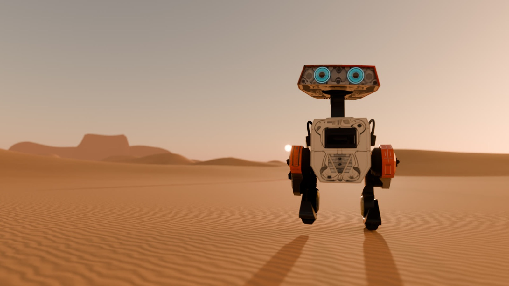
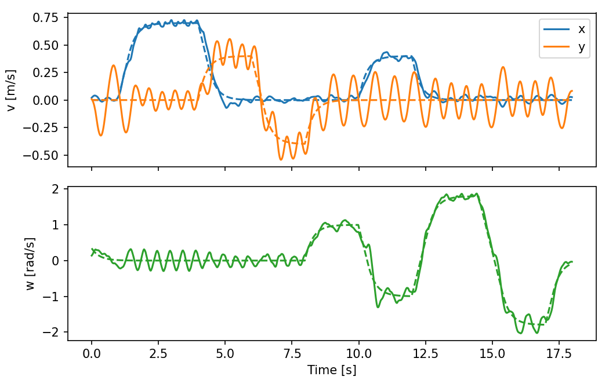
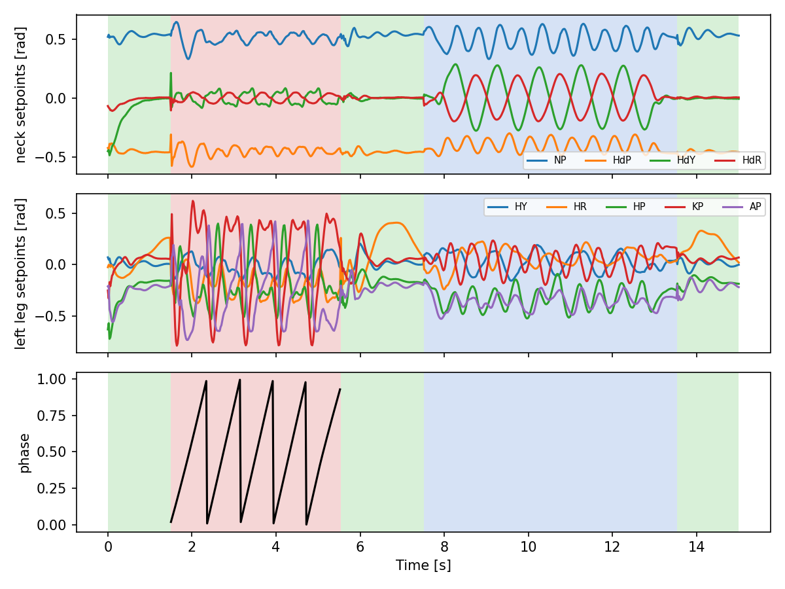

<div align="center">

# BDX: A New Gait

**An unofficial, from-the-paper reproduction of Disney Research's bipedal character controller**

*Grandia et al., [Design and Control of a Bipedal Robotic Character](https://www.roboticsproceedings.org/rss20/p103.html), RSS 2024*

[](LICENSE)
[](pyproject.toml)
[](https://github.com/mujocolab/mjlab)
[](https://github.com/google-deepmind/mujoco_warp)
[](https://arxiv.org/abs/2501.05204)

English · [中文](README.zh-CN.md)



</div>

A small droid learns to stand, walk, dance, jump and throw a tantrum in thousands of simulated worlds at once. This repository rebuilds the paper's reinforcement-learning stack from its text and tables alone, sets every number beside the paper's, and turns the trained policies into a short film.

> [!NOTE]
> This is an independent research reproduction. It is not affiliated with or endorsed by Disney or Lucasfilm, and it contains none of their code, CAD or animation. The robot is the open-source [BDX-R](https://github.com/KaydenKnapik/BDX-R-Description), rebuilt to the paper's dimensions. See [NOTICE](NOTICE).

## Highlights

- **Every piece of the paper:** the actuator model, the action pipeline, three reference generators (standing IK, gait-authoring tool, episodic clips), seven policies, the runtime that hands state between them, and the three-layer animation engine.
- **Paper-scale training:** 8,192 envs × 24 steps × 100,000 PPO iterations per policy, 600 Hz physics, on one RTX 4090 workstation.
- **Measured, not eyeballed:** 15,360 simulated seconds per policy with disturbances on, and no falls.
- **A film rendered from the policies:** every pose is a recorded rollout; Blender adds only light, lens, sand and sound.

## Results

**Table III: joint tracking error (MAE, rad), lower is better**

> [!NOTE]
> Both columns are simulation numbers, but "Ours" is measured on a rebuilt BDX-R model and our own actuator and reference implementation, not on Disney's robot. Read it as "the same metric on a comparable setup", not as beating the paper.

| Policy | Paper | Ours |
|---|---:|---:|
| Standing (perpetual) | 0.035 | **0.017** |
| Walking (periodic) | 0.123 | **0.043** |
| Excited (episodic) | 0.029 | **0.028** |
| Happy dance (episodic) | 0.027 | **0.025** |
| Jump (episodic) | 0.043 | **0.022** |
| Tantrum (episodic) | 0.032 | *training* |

**Velocity tracking:** 0.7 m/s commanded → 0.696 m/s measured; ±1.8 rad/s turns (the paper's maximum) → +1.749 / −1.754 rad/s.
**Jump:** every world leaves the ground, 0.19 s of flight, 8 cm foot clearance.
**Pushes:** 99–100 % survival up to 180 N while walking.

<p align="center">
  
  
</p>

The full write-up, with every deviation from the paper and every bug that had to be fixed, is in **[docs/REPORT.md](docs/REPORT.md)**. How the project got there, stage by stage, is in [docs/HISTORY.md](docs/HISTORY.md).

## Quick start

You need Linux with an NVIDIA GPU (MuJoCo Warp runs on CUDA) and Python 3.10.

```bash
git clone <this-repo> bdx-new-gait && cd bdx-new-gait
uv venv --python 3.10 && source .venv/bin/activate
uv pip install -e .
```

Check that the tasks build and step:

```bash
python scripts/smoke_env.py Disney-BDX-Walking
```

### Use the released policies

Download `checkpoints/*.pt` from the release page, then:

```bash
export DISNEY_WALK_TABLE=calm
python scripts/eval_policy.py Disney-BDX-Walking checkpoints/bdx_walking.pt --video walk.mp4
python scripts/bdx_eval.py mae Disney-BDX-Walking checkpoints/bdx_walking.pt   # Table III row
python scripts/bdx_eval.py veltrack checkpoints/bdx_walking.pt                  # Fig. 7
python scripts/jump_stats.py checkpoints/bdx_jump.pt                           # flight statistics
```

### Train from scratch

All final policies used the same settings; only the task, the entropy coefficient and the walking flags differ.

```bash
export DISNEY_WALK_TABLE=calm          # the calm gait reference used for every result
COMMON="--env.scene.num-envs 8192 --agent.max-iterations 100000 --agent.save-interval 2500"

python scripts/train.py Disney-BDX-Standing                 $COMMON --agent.algorithm.entropy-coef 0.0
python scripts/train.py Disney-BDX-Episodic-happy_dance     $COMMON --agent.algorithm.entropy-coef 0.0
python scripts/train.py Disney-BDX-Episodic-excited         $COMMON --agent.algorithm.entropy-coef 0.0
python scripts/train.py Disney-BDX-Episodic-jump            $COMMON --agent.algorithm.entropy-coef 0.005
python scripts/train.py Disney-BDX-Episodic-tantrum         $COMMON --agent.algorithm.entropy-coef 0.005
DISNEY_TERRAIN=1 DISNEY_TABLE1=1 \
python scripts/train.py Disney-BDX-Walking                  $COMMON --agent.algorithm.entropy-coef 0.005
```

One run takes about 40 hours on an idle RTX 4090. Resume an interrupted run with `--agent.resume True --agent.load-run <run_dir> --agent.load-checkpoint model_<N>.pt`.

| Variable | Default | Meaning |
|---|---|---|
| `DISNEY_WALK_TABLE` | *(unset)* | `calm` selects `walk_table_calm.npz`, whose step cycle stretches at low speed |
| `DISNEY_TERRAIN` | `0` | `1` trains walking on random rough terrain and small obstacles |
| `DISNEY_TABLE1` | `0` | `1` keeps the paper's Table I reward weights unchanged |
| `DISNEY_SURV`, `DISNEY_SURV_CURRIC` | — | survival weight, or a `w0,w1,it0,it1` curriculum on it |
| `DISNEY_SIM_HZ` | `600` | physics rate; the policy always runs at 50 Hz |

## Repository layout

```
disneyrepro/
  bdx/          robot config, tasks, standing IK reference, episodic clips, runtime
  rl/           actuator model, action pipeline, shared rewards and observations
  gait/         gait-authoring tool (step planner, LIPM, whole-body IK)
  kin/          batched torch kinematics and leg IK
  robots/       BDX-R model and builder (plus experimental dino / Olaf builders)
scripts/        training, evaluation, figures and diagnostics (see scripts/README.md)
blender/        the film pipeline: bake, shots, footprints, score, titles, cut (see blender/README.md)
site/           bilingual results page (open site/index.html)
docs/           REPORT.md and figures
```

## The film

*BDX: A New Gait* is a ten-chapter, two-minute short in English and Chinese. A scout wakes under two suns, follows a signal across the dunes and at nightfall finds that someone answers. Each chapter is one policy doing what it was trained to do. The rendered films are attached to the release; [blender/README.md](blender/README.md) explains how to rebuild them.

## Contributing

Results from other GPUs, closer matches to the paper and fixes are welcome; see [CONTRIBUTING.md](CONTRIBUTING.md) and the [Code of Conduct](CODE_OF_CONDUCT.md). Changes are listed in [CHANGELOG.md](CHANGELOG.md).

## Citation

If this code helps your work, please cite the original paper:

```bibtex
@inproceedings{grandia2024bdx,
  title     = {Design and Control of a Bipedal Robotic Character},
  author    = {Grandia, Ruben and Knoop, Espen and Hopkins, Michael A. and Wiedebach, Georg
               and Bishop, Jared and Pickles, Steven and M{\"u}ller, David and B{\"a}cher, Moritz},
  booktitle = {Proceedings of Robotics: Science and Systems},
  year      = {2024},
  doi       = {10.15607/RSS.2024.XX.103}
}
```

## License

Code is released under the [Apache License 2.0](LICENSE). The BDX-R meshes are MIT-licensed and the original BDX-R MJCF is Apache-2.0; both licenses are kept in [`disneyrepro/robots/bdxr/`](disneyrepro/robots/bdxr/). See [NOTICE](NOTICE) for attributions.

Built on [mjlab](https://github.com/mujocolab/mjlab), [MuJoCo Warp](https://github.com/google-deepmind/mujoco_warp), [rsl_rl](https://github.com/leggedrobotics/rsl_rl) and [Blender](https://www.blender.org).
