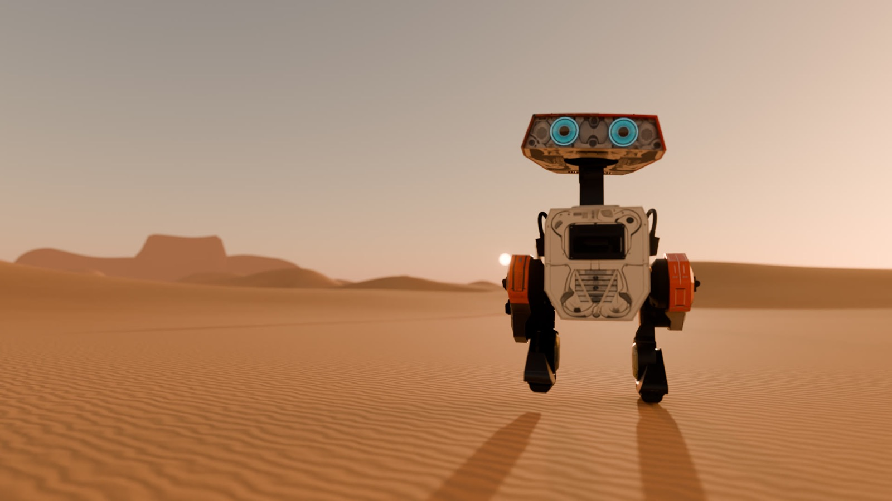
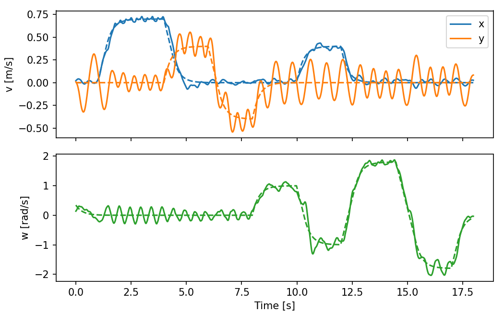
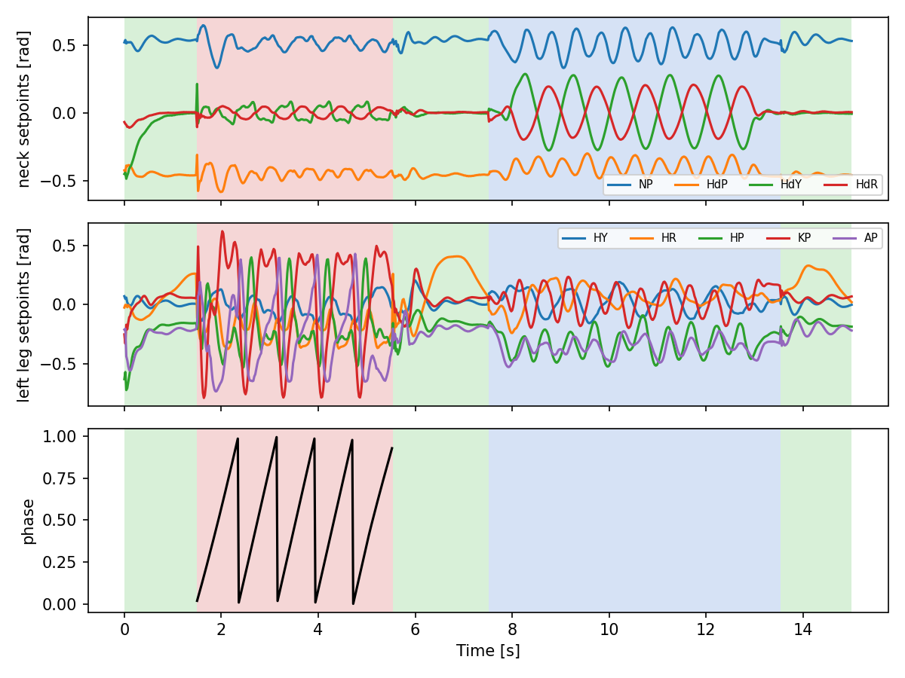

<div align="center">

# BDX：新的步态

**按论文从零复现迪士尼研究院的双足角色机器人控制器（非官方）**

*Grandia 等，[Design and Control of a Bipedal Robotic Character](https://www.roboticsproceedings.org/rss20/p103.html)，RSS 2024*

[](LICENSE)
[](pyproject.toml)
[](https://github.com/mujocolab/mjlab)
[](https://github.com/google-deepmind/mujoco_warp)
[](https://arxiv.org/abs/2501.05204)

[English](README.md) · 中文



</div>

一台小机器人在成千上万个并行的仿真世界里，学会了站立、行走、跳舞、起跳和发脾气。本仓库只依据论文的正文和表格，重建了整套强化学习系统。每个数字都与论文对照，训练好的策略还被做成了一部短片。

> [!NOTE]
> 这是独立的研究复现，与迪士尼、卢卡斯影业无关，也未获其认可。仓库不含它们的任何代码、CAD 或动画。机器人用的是开源的 [BDX-R](https://github.com/KaydenKnapik/BDX-R-Description)，按论文尺寸改造。署名见 [NOTICE](NOTICE)。

## 亮点

- **论文的每个部分都实现了：** 执行器模型、动作管线、三种参考生成器（站立 IK、步态编辑工具、情景动作片段）、七个策略、在策略之间传递状态的运行时，以及三层动画引擎。
- **按论文规模训练：** 每个策略 8,192 个环境 × 24 步 × 100,000 次 PPO 迭代，物理 600 Hz，一张 RTX 4090 即可。
- **数字靠测量：** 每个策略在扰动下评估 15,360 仿真秒，没有一次摔倒。
- **策略拍成电影：** 每个姿态都是策略的真实录制；Blender 只负责灯光、镜头、沙地和声音。

## 结果

**表 III：关节跟踪误差（MAE，弧度），越低越好**

> [!NOTE]
> 两列都是仿真数字，但“本复现”是在重建的 BDX-R 模型和我们自己实现的执行器、参考动作上测的，不是迪士尼的机器人。请把它理解为“可比设置下的同一指标”，而不是超过了论文。

| 策略 | 论文 | 本复现 |
|---|---:|---:|
| 站立（持续） | 0.035 | **0.017** |
| 行走（周期） | 0.123 | **0.043** |
| 兴奋（情景） | 0.029 | **0.028** |
| 欢乐舞（情景） | 0.027 | **0.025** |
| 跳跃（情景） | 0.043 | **0.022** |
| 发脾气（情景） | 0.032 | 0.033 |

**速度跟踪：** 指令 0.7 m/s，实测 0.696 m/s；±1.8 rad/s 转向（论文上限）实测 +1.749 / −1.754 rad/s。
**跳跃：** 所有世界都真正离地，腾空 0.19 s，脚离地 8 cm。
**推搡：** 行走中受 180 N 以内的推力，存活率 99–100 %。

<p align="center">
  
  
</p>

完整报告（与论文的所有偏差、所有修过的 bug）见 **[docs/REPORT.md](docs/REPORT.md)**（英文）；项目一步步走到这里的过程见 [docs/HISTORY.md](docs/HISTORY.md)。

## 快速开始

需要 Linux、NVIDIA GPU（MuJoCo Warp 运行在 CUDA 上）和 Python 3.10。

```bash
git clone <this-repo> bdx-new-gait && cd bdx-new-gait
uv venv --python 3.10 && source .venv/bin/activate
uv pip install -e .
```

检查任务能否构建并运行：

```bash
python scripts/smoke_env.py Disney-BDX-Walking
```

### 使用发布的策略

从 Release 页面下载 `checkpoints/*.pt`，然后：

```bash
export DISNEY_WALK_TABLE=calm
python scripts/eval_policy.py Disney-BDX-Walking checkpoints/bdx_walking.pt --video walk.mp4
python scripts/bdx_eval.py mae Disney-BDX-Walking checkpoints/bdx_walking.pt   # 表 III 的一行
python scripts/bdx_eval.py veltrack checkpoints/bdx_walking.pt                  # 图 7
python scripts/jump_stats.py checkpoints/bdx_jump.pt                           # 腾空统计
```

### 从零训练

所有最终策略设置相同，只有任务、熵系数和行走的开关不同。

```bash
export DISNEY_WALK_TABLE=calm          # 所有结果都用这份平缓步态参考
COMMON="--env.scene.num-envs 8192 --agent.max-iterations 100000 --agent.save-interval 2500"

python scripts/train.py Disney-BDX-Standing                 $COMMON --agent.algorithm.entropy-coef 0.0
python scripts/train.py Disney-BDX-Episodic-happy_dance     $COMMON --agent.algorithm.entropy-coef 0.0
python scripts/train.py Disney-BDX-Episodic-excited         $COMMON --agent.algorithm.entropy-coef 0.0
python scripts/train.py Disney-BDX-Episodic-jump            $COMMON --agent.algorithm.entropy-coef 0.005
python scripts/train.py Disney-BDX-Episodic-tantrum         $COMMON --agent.algorithm.entropy-coef 0.005
DISNEY_TERRAIN=1 DISNEY_TABLE1=1 \
python scripts/train.py Disney-BDX-Walking                  $COMMON --agent.algorithm.entropy-coef 0.005
```

在空闲的 RTX 4090 上，一次训练约 40 小时。中断后可用 `--agent.resume True --agent.load-run <run_dir> --agent.load-checkpoint model_<N>.pt` 继续。

| 环境变量 | 默认 | 含义 |
|---|---|---|
| `DISNEY_WALK_TABLE` | *（不设）* | 设为 `calm` 时用 `walk_table_calm.npz`，低速时步态周期拉长 |
| `DISNEY_TERRAIN` | `0` | `1` 表示行走在随机粗糙地形和小障碍上训练 |
| `DISNEY_TABLE1` | `0` | `1` 表示完全使用论文表 I 的奖励权重 |
| `DISNEY_SURV`、`DISNEY_SURV_CURRIC` | — | 存活奖励权重，或其课程 `w0,w1,it0,it1` |
| `DISNEY_SIM_HZ` | `600` | 物理频率；策略始终 50 Hz |

## 目录结构

```
disneyrepro/
  bdx/          机器人配置、任务、站立 IK 参考、情景片段、运行时
  rl/           执行器模型、动作管线、共用奖励与观测
  gait/         步态编辑工具（落脚规划、LIPM、全身 IK）
  kin/          批量 torch 运动学与腿部 IK
  robots/       BDX-R 模型与构建脚本（另有实验性的 dino / Olaf 构建器）
scripts/        训练、评估、出图与诊断（见 scripts/README.md）
blender/        电影管线：烘焙、镜头、脚印、配乐、字幕、剪辑（见 blender/README.md）
site/           中英双语结果网页（打开 site/index.html）
docs/           REPORT.md 与配图
```

## 短片

《BDX：新的步态》共十章、约两分钟，有中英文两版。一台侦察机器人在双日下醒来，循着信号穿越沙丘，在夜幕降临时发现有人回应。每一章都是一个策略在做它被训练去做的事。成片附在 Release 中，重建方法见 [blender/README.md](blender/README.md)。

## 参与贡献

欢迎提交其他 GPU 上的结果、更贴近论文的改进和各种修复，见 [CONTRIBUTING.md](CONTRIBUTING.md) 与[行为准则](CODE_OF_CONDUCT.md)。版本变更见 [CHANGELOG.md](CHANGELOG.md)。

## 引用

如果本项目对你有帮助，请引用原论文：

```bibtex
@inproceedings{grandia2024bdx,
  title     = {Design and Control of a Bipedal Robotic Character},
  author    = {Grandia, Ruben and Knoop, Espen and Hopkins, Michael A. and Wiedebach, Georg
               and Bishop, Jared and Pickles, Steven and M{\"u}ller, David and B{\"a}cher, Moritz},
  booktitle = {Proceedings of Robotics: Science and Systems},
  year      = {2024},
  doi       = {10.15607/RSS.2024.XX.103}
}
```

## 许可证

代码采用 [Apache License 2.0](LICENSE)。BDX-R 网格为 MIT 许可，原始 BDX-R MJCF 为 Apache-2.0，两份许可证都保留在 [`disneyrepro/robots/bdxr/`](disneyrepro/robots/bdxr/)。署名见 [NOTICE](NOTICE)。

基于 [mjlab](https://github.com/mujocolab/mjlab)、[MuJoCo Warp](https://github.com/google-deepmind/mujoco_warp)、[rsl_rl](https://github.com/leggedrobotics/rsl_rl) 和 [Blender](https://www.blender.org) 构建。
