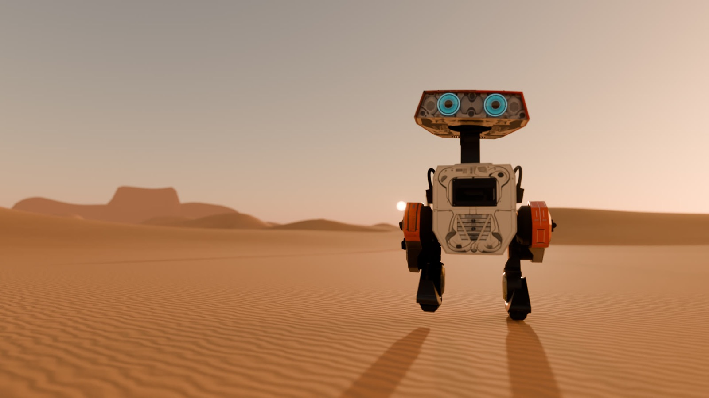
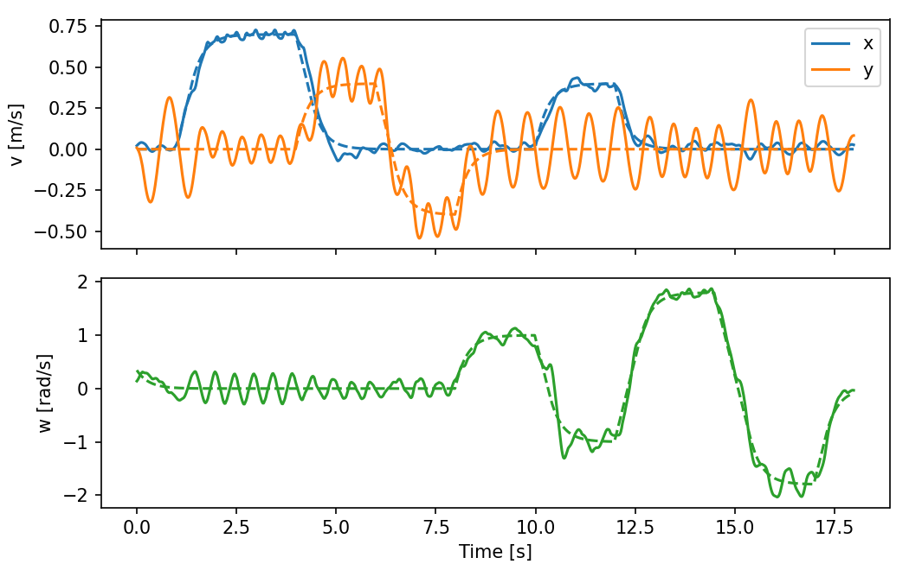
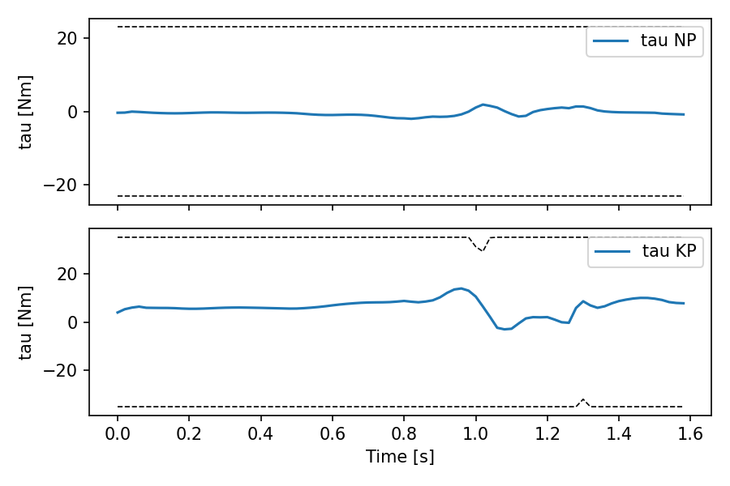
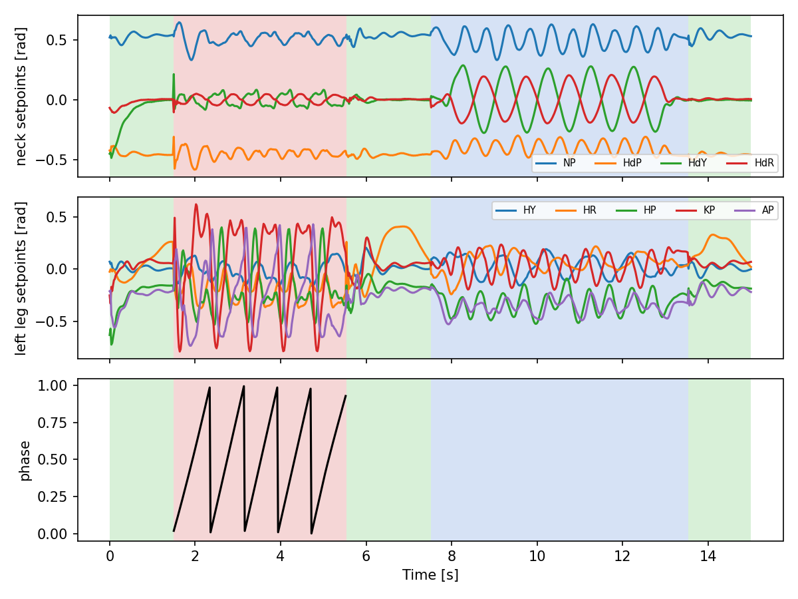
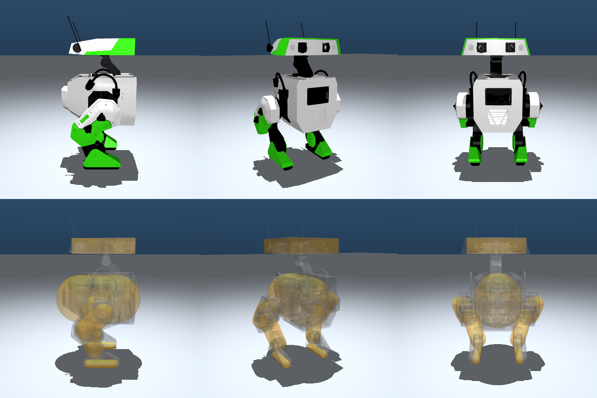
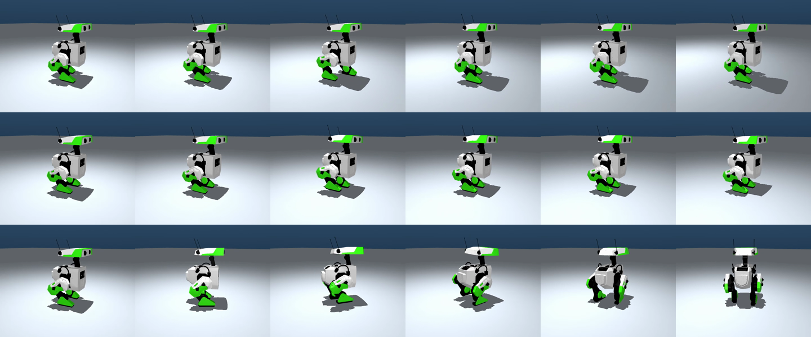
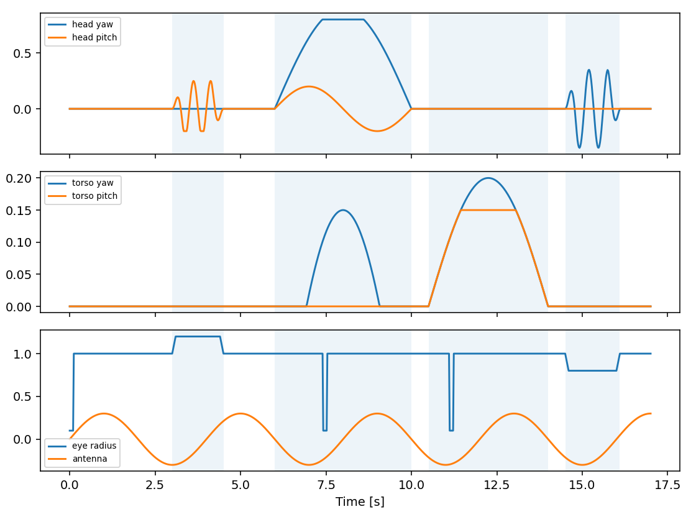

# BDX: A New Gait — reproducing *Design and Control of a Bipedal Robotic Character*

*A small droid learned to walk in thousands of simulated worlds at once. This is how it was taught, measured against the paper that taught it first.*

Grandia, Knoop, Hopkins, Wiedebach, Bishop, Pickles, Müller and Bächer, *Design and Control of a Bipedal Robotic Character* (RSS 2024), describes the reinforcement-learning stack behind Disney's BDX droids. This repository rebuilds that stack from the paper's text and tables alone:
- the actuator model;
- the three reference generators;
- all seven policies;
- the runtime that switches between them, and the ablations.

Every number is set beside the paper's own.

> **Film:** English and 中文 cuts, ten chapters, about two minutes (attached to the GitHub release; rebuild with Sec. 6). A scout wakes under two suns, follows a signal across the dunes, weathers the wind, and at nightfall finds that someone answers. Every pose of every droid is a recorded rollout of a trained policy; Blender adds only light, lens and paint.
> **Web page:** a bilingual results page lives in [`site/`](../site/index.html).



---

## 1. Headline results

These are the final, paper-length runs: 100,000 PPO iterations per policy at 8,192 × 24, 600 Hz physics, on a robot rebuilt to the paper's geometry (Sec. 2.1). Each policy was evaluated for 15,360 simulated seconds (256 environments × 60 s, disturbances on). **None fell.**

**Table III: joint tracking error, MAE in rad.** Lower is better.

| Policy | Paper | Ours | Notes |
|---|---:|---:|---|
| Standing (perpetual) | 0.035 | **0.017** | random 8-D head/torso commands |
| Walking (periodic), flat | 0.123 | **0.043** | random vx, vy, ωz, head commands; Table I weights |
| Walking, rough terrain | — | 0.044 | same policy on the randomized terrain it trained on; 0 falls |
| Walking, second recipe | — | 0.045 | Olaf weights + survival curriculum (hedge run) |
| Excited (episodic) | 0.029 | **0.028** | procedural clip |
| Happy dance (episodic) | 0.027 | **0.025** | procedural clip |
| Jump (episodic) | 0.043 | **0.022** | ballistic clip, airborne 0.19 s |
| Tantrum (episodic) | 0.032 | 0.033 | procedural clip; retrained on the new geometry |

**Velocity tracking** (Fig. 7 analogue; steady-state mean over the last half of each 2–3 s segment, measured in the path frame):

| Command | Measured |
|---|---|
| forward 0.7 m/s | 0.696 m/s |
| lateral +0.4 / −0.4 m/s | +0.416 / −0.442 m/s |
| turn 1.0 rad/s | 0.947 rad/s |
| combined (0.4 m/s, −1.0 rad/s) | (0.386 m/s, −0.932 rad/s) |
| **turn +1.8 / −1.8 rad/s (the paper's maximum)** | **+1.749 / −1.754 rad/s** |

Standing still after walking or a fast turn, the torso drifts less than 1.2 mm/s (64 worlds, 8 s after a 2 s settle; [`scripts/drift_test.py`](../scripts/drift_test.py)).

**The jump** (64 worlds): all leave the ground, for 0.19 s on average (0.16–0.20 s; the reference flight is 0.22 s). Feet clear the sand by 8.0 cm and the torso rises 8.6 cm, with no falls. Unlike the paper's Fig. 8, the knee never reaches its torque limit: it peaks at about 14 Nm against a 30–35 Nm limit.

**Push robustness:** horizontal 0.1 s push on the torso, random direction, 128 envs per magnitude.

| Force (N) | 0 | 30 | 60 | 90 | 120 | 150 | 180 |
|---|---:|---:|---:|---:|---:|---:|---:|
| Walking 0.3 m/s, survival | 100 % | 100 % | 100 % | 100 % | 99 % | 100 % | 99 % |
| Standing, survival | 100 % | 100 % | 100 % | 92 % | 100 % | 100 % | 100 % |

**Policy transitions** (Fig. 9 analogue): the sequence was stand → walk → stand (switching at double support) → happy dance → stand, with no fall. Setpoint jumps at the four switches were 0.40, 0.49, 0.27 and 0.13 rad, against a per-step p99 of 0.32 rad during normal motion. The walk-in and walk-out switches are rougher than ordinary control, because the calm gait's first step is long.





---

## 2. What was built

### 2.1 Robot

The paper's droid is not public. We used the open-source **BDX-R** (Apache-2.0, 14 actuated DoF) as a stand-in, re-massed to the paper's distribution: torso 5.8 kg, each leg 3.6 kg, head 2.4 kg, 15.4 kg in total. Its structure was then changed to match the paper's Sec. IV: the neck is lengthened by 6.6 cm so the robot stands 0.66 m tall without antennas, and the hip yaw (±0.6 rad) and hip roll (−0.45 to 0.6 rad) ranges are widened so it can turn at the paper's 1.8 rad/s. Collision geometry uses rounded capsule soles (r = 0.02 m), fitted leg capsules and an oriented head box, with bit-masked contact pairs. Builder: [`disneyrepro/robots/bdxr/build.py`](../disneyrepro/robots/bdxr/build.py).



### 2.2 Actuators and action pipeline (Sec. IV, Table VI, Eqs. 14–20)

- **Actuator model** ([`disneyrepro/rl/disney_actuator.py`](../disneyrepro/rl/disney_actuator.py)), covering:
  - encoder offset;
  - backlash;
  - Coulomb + viscous friction;
  - velocity-dependent torque limits;
  - sensor noise;
  - the Dynamixel PD on the setpoint-error derivative.

  Three motor classes:

  | Motor | Joints |
  |---|---|
  | Unitree A1 | hip roll, hip pitch, knee |
  | Unitree Go1 | hip yaw, ankle, neck pitch |
  | Dynamixel XH540 | head pitch, yaw, roll |

- **Action pipeline** ([`disneyrepro/rl/disney_action.py`](../disneyrepro/rl/disney_action.py)): the policy runs at 50 Hz. Its setpoints go through first-order hold → 37.5 Hz low-pass → clipping to the reference-centred range, into 600 Hz physics (decimation 12), the paper's low-level rate.

### 2.3 Reference generators

- **Standing (perpetual):**
  - Batched torch IK samples the 8-D command space: head height, yaw, pitch and roll, plus torso height, yaw, pitch and roll.
  - An MLP fitted to dense IK samples ([`disneyrepro/bdx/standing_ref.py`](../disneyrepro/bdx/standing_ref.py)) gives smooth, differentiable references.
- **Walking (periodic):** a gait-authoring tool, reimplemented from *Stylized Gaits* ([`disneyrepro/gait/`](../disneyrepro/gait/)). It has a phase-mapped step planner, heel-toe and sample blending, and a LIPM CoM computed by convolution with (ω/2)e^{−ω|τ|}. Batched IK runs over a 11 × 7 × 7 (vx, vy, ωz) grid with 64 time-uniform phases each. The resulting table is GPU-interpolated at run time ([`disneyrepro/rl/walk_table.py`](../disneyrepro/rl/walk_table.py)).

  

- **Episodic:** procedural animation clips for happy dance, excited and tantrum, and a ballistic jump. The jump crouches 5 cm, pushes for 0.15 s to a 1.07 m/s take-off and flies for 0.22 s (5.8 cm rise); the feet tuck 3 cm and the head pitches up in flight ([`disneyrepro/bdx/episodic.py`](../disneyrepro/bdx/episodic.py)).

### 2.4 RL formulation (Sec. V)

- Observations: the policy state of Eq. 8 (path-frame base pose and velocity, joint states, the last two actions, phase and commands).
- Rewards: imitation rewards from Table I, plus the paper's regularizers and a survival reward.
- Domain randomization: Table V disturbances (pushes, masses, friction, motor parameters).
- Optimizer: PPO with Table IV hyper-parameters (actor and critic 3 × 512 ELU, 24 steps per env, 5 epochs, 4 minibatches, adaptive learning rate, KL target 0.01).
- Scale: 8,192 parallel envs × 24 steps, 100,000 iterations, as in the paper, in **mjlab 1.6 / MuJoCo Warp**, on one RTX 4090 workstation (1.3–1.6 s per iteration) and a shared 8 × RTX PRO 6000 server (2.3–4 s per iteration under contention).
- Jump: the paper's App. A emphasis reward (Eq. 13). Inside the take-off-to-landing window it adds a torso-height reward and extra weight on torso orientation and on foot contact.
- Initialization: reference-state initialization with reference velocities.
- Walking only: a survival-weight curriculum and terrain randomization.

### 2.5 Runtime (Sec. VI)

[`disneyrepro/bdx/runtime.py`](../disneyrepro/bdx/runtime.py):
- **Policy slots with full state transfer:** a switch carries over the root, joints, actuator/filter internals and action history, converted through setpoint space, plus the path frame. That makes stand ↔ walk ↔ episodic transitions seamless.
- **Three-layer animation engine:** a looping background, triggered clips blended in and out (T_β = 0.1 s, T_α = 0.35 s), and joystick gaze/posture control (Eqs. 9–12).



---

## 3. Ablation: how should walking be formulated? (Sec. VII-B)

All variants were trained with the same budget (5,000 iterations) and evaluated at 0.3 and 0.6 m/s (64 envs × 10 s). This ablation was run earlier, on the original BDX-R geometry at 400 Hz, and was not repeated with the final setup. Contact agreement compares foot contacts with the gait reference's contact schedule.

| Formulation | v (m/s) | Step freq. (Hz) | Clearance (cm) | Contact agreement | MAE vs gait ref (rad) | vx error (m/s) | Falls |
|---|---:|---:|---:|---:|---:|---:|---:|
| **Ours** (imitation + phase) | 0.3 | 1.82 | 3.4 | 0.89 | 0.038 | 0.033 | 0 |
|  | 0.6 | 2.21 | 3.4 | 0.91 | 0.066 | 0.058 | 0 |
| Reference as policy input | 0.3 | 1.83 | 3.7 | 0.92 | 0.044 | 0.036 | 0 |
|  | 0.6 | 2.14 | 4.1 | 0.94 | 0.052 | 0.061 | 0 |
| Velocity reward only | 0.3 | ≈0 | — | 0.59 | 0.42 | 0.29 | 7 |
|  | 0.6 | ≈0 | — | 0.58 | 0.49 | 0.60 | 2 |
| Phase + contact reward | 0.3 | ≈0 | — | 0.59 | 0.20 | 0.30 | 1 |
|  | 0.6 | ≈0 | — | 0.58 | 0.35 | 0.60 | 0 |

- **Reproduced:** feeding the reference to the policy performs about the same as our formulation, as the paper reports.
- **Not reproduced:** at this budget, both reward-only variants learned to stand still rather than walk. The paper describes them as "shuffling" and "stiff". Ours fail more completely, which is consistent with, but stronger than, the paper's point that imitation is what makes stylized walking learnable.

---

## 4. Deviations from the paper

| Topic | Paper | Here | Why |
|---|---|---|---|
| Robot | BDX (in-house) | BDX-R, re-massed and rebuilt to the paper's height and joint ranges | BDX CAD is not public |
| Episodic clips | artist-animated | procedural | no access to the animations |
| Entropy coefficient | 0 | 0.005 for walking, jump and tantrum; 0 for standing, happy dance and excited | with 0, the action std fell from 0.3 to 0.02 in 2,500 iterations; the walker learned to stand still and the jump never left the ground (Sec. 5) |
| Jump emphasis weights (Eq. 13) | not given | height kernel σ = 1.5 cm, extra weights height 12, orientation 3, contact 12 | weaker values (σ ≈ 7 cm, 3/3/4) paid under 5 % of the survival reward, and the policy kept its toes down |
| Jump torques | knees at the torque limit (Fig. 8) | knee peak ≈ 14 Nm, limit 30–35 Nm | the clip reaches its height without saturating the knee |
| Action scale | — | per-joint reference half-range (min 0.3 rad) | head joints were otherwise drowned out by action penalties |
| Gait | — | a calm gait reference: the cycle stretches at low speed (1.0 s in place → 0.48 s at 0.7 m/s) | the paper-matched gait stepped 3.6–4.4 times per second, hurried for a small character |

---

## 5. Things that broke, and the fixes

1. **Walking never stepped.** Five separate causes:
   - Reference velocities came from finite differences after the path-frame projection; they now come from the generator.
   - Resets wrote zero velocities; reference-state initialization now includes reference velocities.
   - A survival weight of 20 rewarded standing still; it now uses a curriculum.
   - **The real bug:** the gait planner integrated phase with Euler steps. It overshot the short double-support segments, so the feet *teleported* at lift-off. Time is now advanced exactly through the phase map: `t ← pm(φ)+dt; φ ← pm⁻¹(t)`.
   - The RL phase was the non-uniform phase-map variable; it is now normalized time.
2. **Standing plateaued at 0.2 rad MAE.** The head action scale was tiny, so neck action penalties dominated, and the action std collapsed. Fixed with reference-range action scaling and entropy 0.005.
3. **The jump stayed on the ground.** Three causes:
   - The clip was not ballistic; it was rebuilt as a ballistic jump.
   - A later sync from the workstation silently overwrote the rebuilt clip. Data directories are now excluded from syncs.
   - The policy needed an incentive to leave the ground; a flight-frame airborne bonus was added.
4. **Misleading training curves.** The tracking metric was logged at reset, the moment of falling. It is now the episode average.
5. **Open-loop MPC was ill-conditioned.** Switched to a DCM terminal constraint for the tool, and to LIPM convolution for references.
6. **The paper-faithful first run collapsed.** With entropy 0, every policy's action std fell to 0.01–0.04 within 2,500 iterations:
   - The walker found that standing still kept it alive: commanded 0.7 m/s, it moved 0 m/s.
   - The jump plateaued at 0 s of flight.
   - Standing and the two dances were fine, and were kept.

   Restarting walking and the jump with entropy 0.005 fixed both. The jump also needed a sharper emphasis reward (Sec. 4).
7. **Training was slower than the step time promised.** Profiling showed the environment step was CPU-bound (47 ms of GPU work against 194 ms of host time). Three fixes made it 2.7× faster on an idle machine:
   - armature randomization moved from every reset to a 40 s interval;
   - disturbances were vectorized;
   - the walk table was packed into one tensor.

   On the shared server, other users' jobs still set the pace.

---

## 6. The film: a walk with a reason

### Story

Each chapter is one policy doing what it was trained to do. Each caption pairs a line of verse with the measured fact behind it.

Chapter titles are plain and descriptive. Two of them nod to the saga ("A New Hope", "Binary Stars"), the opening keeps the crawl and the far-away line, chapters change with horizontal, iris and clock wipes, and the film closes on "May the Force be with you."

| Chapter | English / 中文 | What happens | Policy (recorded rollout) |
|---|---|---|---|
| I | Awakening / 苏醒 | Under two low suns its eyes flicker on; it tries its weight on the sand | standing, 8-channel command script |
| II | The Signal / 信号 | Beyond the dunes a red lamp blinks every 2 s; it turns to listen | animation engine over standing |
| III | The Crossing / 远行 | It walks toward the light, leaving a trail of prints | walking, up to 0.7 m/s |
| IV | Against the Wind / 逆风 | Gusts shove it sideways; it catches itself and walks on | walking under 90 N, 0.1 s pushes |
| V | The Leap / 一跃 | Halfway there, it jumps (0.4x) | jump |
| VI | Arrival / 抵达 | It stops at double support, then dances | stand → walk → stand → happy dance |
| VII | The Long Night / 长夜 | Nothing answers; it stamps its feet | tantrum |
| VIII | An Answer / 回应 | On a far dune a second pair of eyes comes on and nods | standing (two droids) |
| IX | A New Hope / 新希望 | It was never the only one | excited |
| X | Binary Stars / 双星 | Two small machines under a ringed planet, looking up | standing, head pitch +0.5 rad |

### Pipeline

1. **Rollouts.**
   - Story beats are scripted as command sequences and recorded with the final policies ([`scripts/bdx_story.py`](../scripts/bdx_story.py), [`scripts/bdx_story2.py`](../scripts/bdx_story2.py), [`scripts/bdx_transitions.py`](../scripts/bdx_transitions.py), [`scripts/bdx_show.py`](../scripts/bdx_show.py), [`scripts/bdx_videos.py`](../scripts/bdx_videos.py)). Every beat ran with zero falls.
   - [`scripts/export_blender.py`](../scripts/export_blender.py) turns joint angles into world poses for all 81 visual meshes.
2. **Paint.**
   - Meshy retextured 36 parts at 4K with full PBR maps (base colour, roughness, metallic, normal): 20 shell panels in a cleaner livery after the field droids of the space-opera tradition, plus 16 machined sources that also paint their mirrored and duplicate siblings.
   - [`blender/bake.py`](../blender/bake.py) gives each untouched simulation mesh its own UV unwrap, then bakes the aligned Meshy surface onto it with Cycles (selected-to-active). This replaced per-corner UV transfer, which had smeared texture across large CAD triangles.
3. **Eyes** (`add_eyes` in [`blender/bdx_lib.py`](../blender/bdx_lib.py)) are geometry, not texture.
   - Each is a clear glass dome over a procedural iris: thin outer ring, striated teal band, dark pupil. It is sharp at any distance.
   - Each lens is centred on its face-plate opening, which is found from the opening's inner walls.
   - They blink, flicker on at waking, and follow the animation engine's eye channel.
4. **Rendering:** Blender 5.1 Cycles on the RTX 4090 (OptiX).
   - Bevelled edge highlights, motion blur, depth of field, OpenImageDenoise.
   - The twin-sun desert at golden hour and the night variant with a ringed planet.
   - A relay mast whose lamp blinks every 2 s.
   - Wind-blown sand during the gusts.
5. **Footprints and dust** ([`blender/traces.py`](../blender/traces.py)). Every simulated touchdown leaves a print shaped from the foot pad's real outline:
   - The prints sit on a 2.5 mm world lattice, tiled without overlaps, over a matching hole cut in the dunes, so they can sink below the old surface.
   - Floor depth follows the touchdown speed (8–20 mm). The walls slope at sand's 33° angle of repose, with a lumpy rim and a toe push-up.
   - Fresh sand inside a print loses its wind ripples.
   - Each touchdown throws sand grains (particles) and a soft volumetric puff that drifts downwind. Each lift-off lets grains trickle back.
6. **Sound** ([`blender/score2.py`](../blender/score2.py), [`blender/sand_bank.py`](../blender/sand_bank.py)). Every touchdown is a real desert footstep:
   - 92 single steps were cut by onset detection from CC0 field recordings on Freesound, mostly felix.blume's sneakers on dry desert sand (#705743), kept only when they stand at least 18 dB above the noise floor.
   - The 25 softest, least ringing steps are used: spectral peaks are clamped to 2.5x their local median (removing metallic ringing), the band is limited to 120 Hz–6.5 kHz, and the heel transient is tamed. Both feet use the same voice at the same level (±1 dB).
   - Under each step, the sand compresses: a soft 150–700 Hz noise swell.
   - Each lift-off adds a short, soft pour of sand.

   Loudness follows the simulated touchdown speed. The music follows the chapters; an original brass fanfare (not the film theme) opens the title, and the relay lamp is a distant ping.
7. **Titles, in English and Chinese:** the crawl, the end card and the three-line lower thirds are original text, rendered once per language (Chinese set in MiSans); chapters change with the saga's horizontal, iris and clock wipes ([`blender/titles.py`](../blender/titles.py), [`blender/film_cut2.py`](../blender/film_cut2.py)). No franchise logos or fonts are used.

Rebuild (Blender 5.1; the GPU steps want CUDA/OptiX, the cut runs anywhere with ffmpeg):

```bash
# 1. Record the story beats and turn them into world poses
python scripts/bdx_story.py STAND.pt WALK.pt
python scripts/export_blender.py results/bdx/traj/*.npz
# 2. Bake textures, then render each chapter (GPU)
blender -b -P blender/bake.py
BLENDER=blender bash blender/render_story.sh            # all chapters, or name some
# 3. Titles, then the score and the final cut (EN and ZH)
for l in en zh; do for t in intro title crawl end; do
  BDX_CUT=2 BDX_LANG=$l blender -b -P blender/titles.py -- $t; done; done
python blender/film_cut2.py en zh
```
---

### The walker in the film

The film uses the final walker (P2walk). It was trained from scratch on the calm gait reference, so the step rate rises with speed: about 2 steps/s at 0.15 m/s, about 4 steps/s at 0.7 m/s.

The film's crossing starts at 0.15 m/s and settles at 0.4 m/s. In the reunion, the droid:
1. hurries 3.4 m at up to 0.7 m/s;
2. eases off over the last metre and stops at double support;
3. stands for 1 s;
4. switches to the excited policy.

Every story beat, Chapter VII's tantrum included, was recorded with the final policies and ran with zero falls.

---

## 7. Checkpoints

All final runs: 100,000 iterations, 8,192 envs, 600 Hz. The weights are attached to the GitHub release as `checkpoints/*.pt` (rsl_rl format) and load with the task IDs below.

| Policy | Task ID | Release file | Run name |
|---|---|---|---|
| Standing | `Disney-BDX-Standing` | `bdx_standing.pt` | P1stand |
| Walking (film, Table I) | `Disney-BDX-Walking` | `bdx_walking.pt` | P2walk |
| Walking (second recipe) | `Disney-BDX-Walking` | `bdx_walking_second_recipe.pt` | P2walkH |
| Happy dance | `Disney-BDX-Episodic-happy_dance` | `bdx_happy_dance.pt` | P1happy |
| Excited | `Disney-BDX-Episodic-excited` | `bdx_excited.pt` | P1exc |
| Jump | `Disney-BDX-Episodic-jump` | `bdx_jump.pt` | P2jump (resumed once at 65k) |
| Tantrum | `Disney-BDX-Episodic-tantrum` | `bdx_tantrum.pt` | P2tantrum |

The ablation policies (Sec. 3, 5,000 iterations each) and the earlier short runs on the original BDX-R geometry (W15, W16calm, E1, E8air) are not released.
